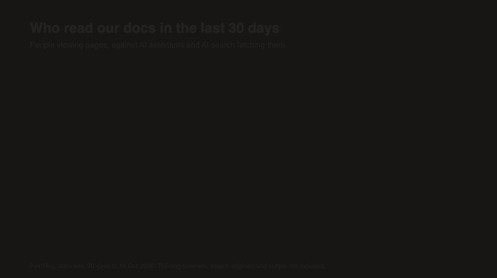

<!--
DRAFT 3 (voice pass). Numbers: PostHog, docs project, 30 days to 2026-10-14. Re-pull them the week this is published, and re-render the illustration.
-->

One of the things that I've been working on is being more data driven - and I spent some time looking at the analytics to our public /docs site to see how it was being used.

I shouldn't have been surprised (but I was, anyway) about the ratio of AI and bots hitting the site as opposed to human users.

<!-- JOEL: DATA (2026-10-21): your "bots disguised as humans" is literally true. The 41 Firefox bot sessions from post 8 made 333 of the 2,266 production docs pageviews (Sep 14 to Oct 14, $host agilitycms.com), about 15%. Real humans were closer to 1.9k, so agents outnumber people by more like 3 to 1. Optional callback: "...and some of those 'humans' turned out to be a bot. More on that in post 8." -->
In the last 30 days, humans (or bots disguised as humans) viewed pages on our documentation site about 2.5k times - it's not super high traffic. In those same 30 days, AI assistants and AI search tools fetched our pages about 5.7k times. That's ChatGPT, Claude, Perplexity etc, reading our docs.  I presume these visits to be on behalf of somebody running an agent and doing research. Those queries may or may not lead to website visits by those users.

That's not counting the training crawlers (another 6.8k requests), the regular search engines (5.4k) or all the scripts that hit any public site - those are a different story - these 5.7k are READERS... they just aren't PEOPLE.

So... who is your website actually for? Or better yet - who is it for *NOW*?

I've been building websites for a long time, and I run the tech and product side of a Headless CMS company, so I've spent a LOT of time thinking about how people read web pages. That number made me re-examine what we're building for on our sites.

That's what this series is about - raising the bar for both kinds of reader, the humans AND the bots. What I've learned on our sites, I wanna help you improve on yours, too!



## The standard

**Your website should work well for 2 kinds of reader: the people who visit it, and the AI agents that read it for them.**

That doesn't mean building 2 sites (please don't!), and it doesn't mean making things worse for people either. In my experience, almost everything that helps an agent helps a person too... there are a few spots where that isn't true, and I'll point them out when we get there.

## What does an agent actually need?

<!-- JOEL: A real moment helps here: a time you (or a customer, or sales) asked ChatGPT or Claude something about Agility and it got it badly wrong, or surprisingly right. How do YOU use AI assistants for research now? -->

In general, a search engine crawler mostly cared about titles, links and speed - it read your page so it could send a person there later, and that was kinda the whole job.

An agent is a different animal. When somebody asks Claude "how does pagination work in this API?" or asks ChatGPT "does this CMS support multiple languages?", here's roughly what the assistant does:

1. It searches for likely pages, often using the whole question as the query.
2. It fetches those pages and reads the whole thing (not just the title).
3. Then it answers in its own words, hopefully with a link back to you.


We really started noticing issues when we created an MCP server for our docs site, and it was based on the same internal search (Algolia first, now Azure AI Search). What we found is that the agent's using the MCP would search for FAR more interesting things, with long queries, and then when that didn't work, the agent would call again and again for less specific queries. This SOMETIMES worked ok, but it certainly wasn;t efficient.  Once we were doing a better job of longer search handling, things changed for the humans those agents were answering for, too!

Here's a real one from our logs: an agent asked for "How to use Web Studio visual page editing components preview editing pages", and 5 seconds later it tried again with just "Web Studio". That kind of back-and-forth showed up in about 1 in 11 agent searches before we fixed things (71 of 788)!

<!-- JOEL: DATA (2026-10-15, App Insights Agility-Docs-MCP-Server, Jul 20 to Oct 6): 788 search_docs calls before the Algolia fix; 31 chains (71 searches) where a query of 6+ words was followed within 90 s by shorter related ones. Hit counts were only logged for 19 of the 788, so we can't prove the first one failed (the line above doesn't claim it). Average query length was 4.5 words, about the same after the fix, so "long queries" is true of the chains, not of every search. We can't tell your own testing apart from customers' agents. -->

<!-- JOEL: Claude changed the end of your sentence above (2026-10-15). It said "things changed for human uses too", but the 4 settings only apply to agent search; the site search box still uses Algolia's defaults on purpose (post 2 explains why). The new ending keeps your point - people benefit through the agents answering them. Revert if you meant something else. -->

So if your search can't handle a question, the agent grabs the wrong page. And if your page is mostly navigation, scripts and cookie banners, the agent has to guess which part is the actual answer. Either way somebody gets a vague (or flat-out WRONG) answer, and your product's name is sitting right there next to it.

## The 10-minute check

You can do this today, on any site, with a browser and an AI assistant - no fancy tools needed.

1. **Pick 3 questions your site answers.** Real ones, from support tickets or sales calls, written the way a customer would actually ask them.
2. **Ask an AI assistant each one** (ChatGPT, Claude, Copilot, whatever your customers use). Does it find your page? A competitor's page? Or does it just make something up?
3. **Type the same 3 questions into your own site search**, exactly as written. How many come back empty?
4. **Fetch one page the way a machine would:** `curl -s https://your-site.com/some-page | less`. Is the answer in the HTML, or does it only show up after JavaScript runs?
5. **Check your analytics for AI traffic.** Can you tell how many requests came from AI assistants last month? If you can't, you don't really know how big your second audience is.

Most sites fail at least 2 of these. Ours failed 3 (yep, really).

## Why does this keep happening?

<!-- JOEL: You lived this one in 2019: you wrote "Prerender your SPA using Netlify For Better SEO" because crawlers couldn't run JavaScript. Same problem, new reader. A line tying that back would be great, plus any default YOU picked years ago that made sense at the time. -->

Nobody sets out to build a site that agents can't read. I've written about this since 2019.  SOME crawlers can render and read JS driving sites, but it's not something you want to rely on. Every reader is not a person USED to mean crawlers only, but not it's a much more diverse set of bots.

The usual suspects are defaults that made total sense back when the reader was almost always a person:

- **Search tuned for keywords.** Lots of search engines require every word in the query to match, by default. People typed keywords, so that was fine! But agents type whole questions, and so do more and more people - "Can I schedule content to publish later" has words in it that your scheduling page might never use.
- **Content that only exists after JavaScript runs.** That's fine in a browser, but it's slower and flakier for pretty much anything else.
- **No clean version of the page.** An agent that wants your page gets your menu, your footer and your consent banner too, whether it wants them or not.
- **Analytics that only sees browsers.** If you count pageviews with a JavaScript snippet, you'll never see an agent, because agents don't run your JavaScript. Your biggest audience can be completely invisible to you, which is a little scary, right?

## The short version of the fix

The rest of the series takes each of these one at a time, with code, roughly in order of effort:

1. **Make your site search handle sentences** (post 2). With Algolia, 4 query settings stopped questions from coming back empty, and adding meaning-based search with Azure AI Search put the right page first WAY more often.
2. **Log the searches that find nothing, and actually read the list every week** (post 3). We send a PostHog event for every search, with the result count, from the site and from our agent endpoint.
3. **Measure your search before you change it** (post 4). 50 questions and a scoring script will tell you more than a month of opinions will.
4. **Make sure your build can't quietly delete content** (post 5). Ours did... more on that one later.
5. **Publish a clean Markdown copy of every page, an `llms.txt` index, and an MCP server** (post 6). In Next.js that's a couple of route handlers reading from the same CMS content as your HTML.
6. **If you put an assistant on your site, teach it to say "I don't know"** (post 7).
7. **Keep the human experience fast and accessible, and measure it** (post 8).

None of this is specific to our stack, and I'll point out the equivalents as we go. But I'm gonna show you exactly what we used, because vague advice is kinda the problem this whole series is trying to fix.

## Our stack, so you can follow along

<!-- JOEL: Why these tools? A sentence of opinion on each would help: why Algolia in the first place, why Azure for the vector search, how you feel about Next.js 16 and Cache Components so far. -->

- **Next.js 16** (App Router, with Cache Components) and **React** for the site, hosted on **Vercel**. This is a great stack for quick iteration as well as flexibility, with new features that are actually useful coming out all the time.
- **Agility CMS** for content. BTW: I've been at Agility for 21 years, so take my enthusiasm with a grain of salt. Editors write in the CMS, and the site reads it over GraphQL and the Fetch API.
- **Algolia** for site search - free plan covers a ton of usage on a small site.
- **Azure AI Search**, with embeddings from **Azure OpenAI**, for hybrid (keyword plus vector) search - this is what the AI agents use.
- **PostHog** for analytics, alerts and session replay, including server-side events for agent traffic. Awesome tool - there are others that can do this too, but I like Posthog a LOT.
- An **MCP server** (Model Context Protocol - basically the standard way to give an AI assistant tools) so assistants can search and read the docs directly.

## Counting your agent readers

Step 5 of the check is the one most people can't answer, so here's how we count agent traffic. Remember, agents don't run JavaScript, so a browser analytics snippet never sees them - you have to catch them on the server.

In Next.js 16, every request goes through `proxy.ts` (what used to be called middleware) before anything renders, so that's the spot. The trick is `waitUntil` - the analytics call runs after the response has already gone out, so it never slows a page down.

```ts
// proxy.ts
export async function proxy(request: NextRequest, event: NextFetchEvent) {
	const pathname = request.nextUrl.pathname;

	// First, so every outcome below is counted, and handed to waitUntil
	// so it never delays the response.
	event.waitUntil(
		reportAgentRequest({ pathname, userAgent: request.headers.get("user-agent"), method: request.method })
	);
	// ...
}
```

`reportAgentRequest` matches the user agent against the crawler names each AI company publishes, and drops each one into a category. Order matters here (the first match wins):

```ts
// lib/analytics/agentTraffic.ts
const AGENT_RULES: AgentRule[] = [
	{ pattern: /ChatGPT-User/i, agent: "ChatGPT-User", operator: "OpenAI", category: "ai-assistant" },
	{ pattern: /OAI-SearchBot/i, agent: "OAI-SearchBot", operator: "OpenAI", category: "ai-search" },
	{ pattern: /GPTBot/i, agent: "GPTBot", operator: "OpenAI", category: "ai-training" },
	{ pattern: /Claude-User/i, agent: "Claude-User", operator: "Anthropic", category: "ai-assistant" },
	{ pattern: /ClaudeBot|anthropic-ai/i, agent: "ClaudeBot", operator: "Anthropic", category: "ai-training" },
	{ pattern: /PerplexityBot/i, agent: "PerplexityBot", operator: "Perplexity", category: "ai-search" },
	// ... search engines, SEO tools, curl/python/node, then a generic "bot" fallback
];
```

Then it sends one PostHog event, `docs_agent_request`, with the agent, who runs it, its category and what kind of page it read (HTML, the Markdown copy, `llms.txt` or the MCP server). Each agent gets one fixed ID, there are no person profiles, and we don't store IP addresses or cookies - and nothing gets sent outside production. The whole thing is wrapped in a `try` that swallows every error, because analytics should NEVER, ever break a page.

The categories are really the important part. A training crawler hoovering up data is a totally different thing from ChatGPT fetching a page because somebody asked a question 5 seconds ago, so if you report "AI traffic", split them up or the number doesn't mean much. The 5.7k at the top of this post is only the `ai-assistant` and `ai-search` categories.

A couple of caveats on our numbers, though:

- Agent HTML counts are a *floor*. Our pages are cached at the edge for up to an hour, so a bot that re-reads a popular page within that hour never reaches our code. The Markdown copies and `llms.txt` are only cached for a minute, so those counts are pretty close to complete.
- User agents can lie! Some assistants browse with a normal browser user agent, so they get counted as people (remember those "bots disguised as humans"?). This is a best effort.

## What happened when we tried it

We worked through everything above over a few weeks, with a ton of help from an AI coding agent, and we measured as we went. 2 things really jumped out at me.

**Search mattered more than anything else.** We wrote 52 real questions, each with its correct page, and scored our search against them. Our Algolia setup put the right page first for 25 of the 51 questions that actually have an answer, and Azure AI Search (combining keyword and meaning-based, or vector, search) put it first for 40. For an agent, that's the difference between quoting the right page and quoting the wrong one - kind of a big deal.

**I was wrong. Twice!** After the first test run, I wrote down that "about half the improvement comes from splitting long articles into sections". Sounded right to me! Then we measured it directly, and splitting made no difference to the ranking at all. And later, once every article was indexed properly, the fancy extra step I was most excited about (a semantic reranker that re-reads the top results) turned out to make the ranking slightly WORSE... so now we only use it for its score and ignore the order it gives back. If we hadn't kept measuring, I'd have published confident advice that was just plain false - twice - and you'll see that theme all through this series: measure it before you believe it.

<!-- JOEL: How did being wrong actually feel? Did you tell the team the theory before you measured it? Anything you'd admit to over a beer goes here. -->

A note on being *"wrong"*: it's not always bad, even though it feels crappy. Trust me when I tell you - I've been wrong SO MANY TIMES! But most of the time it led to learnings that have helped my career.

Don't be so afraid of being wrong that you never try stuff!

## And it helps people too

I keep saying this, but it's true - every change in this series helps your human readers as well:

- Search that handles sentences helps the newcomer who types a question because they don't know your vocabulary yet.
- A list of searches that found nothing is a content plan, written by your readers.
- A clean Markdown copy of a page is really easy to paste into your own AI tool (super handy).
- A fast, server-rendered page is a fast page for everyone.

And when an agent-facing change does nothing for people, I'll tell you - promise.

## What's coming up

1. Your website has two kinds of readers now (you're here)
2. Your search should understand a question, not just keywords
3. "No results" is feedback, so collect it
4. Measure your search before you change it
5. Your build should not be able to quietly delete content
6. Every page should be readable by a machine, without a second site
7. An assistant on your site should know when to say "I don't know"
8. Fast, accessible and working everywhere: measured, not assumed

<!-- JOEL: Your why: what do you hope people get out of these 8 posts? What would you tell 2019 Joel about building websites now? -->

I really want to share this stuff - it's super cool! I think we can create a better agent AND human experience in our websites. It's worth the effort, for sure.

## How about you?

Go run the 10-minute check on your own site - which step failed? And if you can measure it, do AI assistants read your site more or less than people do? I'd really love to know if our ratio is typical (or if we're weird!), so drop it in the comments.

Next up: **Your search should understand a question, not just keywords.**

*Full disclosure: an AI coding agent did a LOT of this work with me, and it helped me draft this post, too. The numbers come from our own measurements, and the mistakes are all mine. :)*
