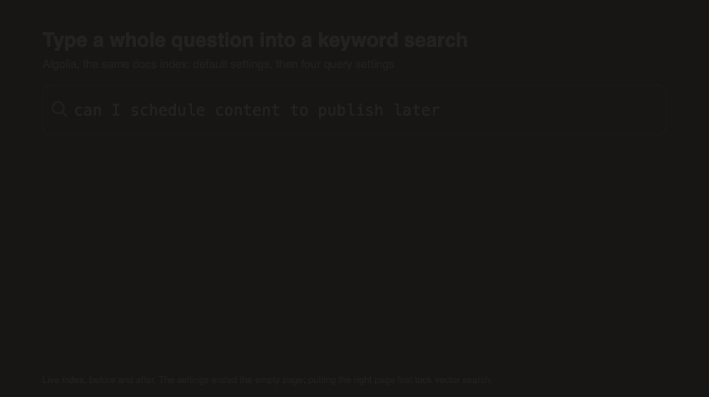

<!--
DRAFT 2 (voice pass). Sources: evals/search/FINDINGS.md, evals/search/JOURNAL.md, lib/search/docsSearch.ts, lib/search/azure.ts, app/api/mcp/route.ts.
-->

In the last post I mentioned that we really started noticing issues once we put an MCP server in front of our docs search. The agents using it would ask long questions, and when those didn't work, they'd try again and again with shorter ones. That SOMETIMES got them there, but it sure wasn't efficient... so this one's about search, and what we changed so it can cope with a whole question.

Try this first. Go type this into the search box on your own site: "can I schedule content to publish later".

Don't trim it down to "scheduling" - type the whole sentence, the way a new customer would ask it (or the way an AI assistant would pass it along for them).

When we tried that on our docs, we got zero results. DAMN! And the page that answers it exists. It's called "Scheduling Overview". Search just couldn't see it behind all those extra words. Obviously, in the logs, we would see a long query (with zero results), often get followed up by a shorten query, and sometimes with some fun expletives as they got tired. Everybody expects your search to be as good as google, after all, right?

<!-- JOEL: FACT CHECK: post 3 says our logs show only 5 zero-result searches, none of them long. If the long-query-then-shorter-query pattern (and the expletives) is from older logs, Algolia's dashboard or client sites over the years, say where, so it doesn't clash with post 3. DATA (2026-10-15): I read all 82 search-box queries in PostHog (Sep 17 to Oct 14): no profanity, 5 zero-result searches, and non-staff queries are 1 to 3 words. The only long ones are from staff. So the human search box doesn't show this pattern. If you mean the AGENTS: App Insights confirms it for them (31 long-then-shorter chains before the fix, e.g. "How to use Web Studio visual page editing components preview editing pages" then "Web Studio" 5 s later; post 1 now quotes it). Agents don't swear, though :) -->



## The standard

**When someone types a full question into your site search, they should get an answer, not an empty page.**

If a plain question comes back blank, that's a BUG - your reader didn't do anything wrong, they just asked the way people ask.

## The 10-minute check

All you need for this is a browser and a few real questions (no accounts, no tools, nothing to install).

1. Grab 5 questions from support tickets, sales calls or a chat log, and keep the customer's exact wording.
2. Type each one into your site search as a full sentence. You'll be SO tempted to shorten it into keywords... don't!
3. Count the blank results. Then count the ones where the right page isn't on the first screen.
4. Ask one question in your customer's words, and then again in your product's words. We say "locales", customers say "multiple languages" - does the customer's version find anything?
5. If you've got an AI assistant or an API that searches your content, send it the same 5 sentences. It might be running different settings from your search box (ours was!).

If more than 1 of the 5 comes back empty, your search is tuned for keywords only. Don't feel bad - almost every site's is, out of the box.

## Why your search box chokes on questions

<!-- JOEL: A support or customer story would land well here: somebody who couldn't find something in the docs that was definitely there. -->

Nobody sat down and chose this, it's just what the defaults do.

Most keyword engines, Algolia included, start from one rule: EVERY word in the query has to match (allowing for typos and prefixes). For a 2-word query like "webhook signature", that's exactly what you want. But for "can I schedule content to publish later", it means the page has to contain "can", "I" and "later" as well... and a page about scheduling might not use any of them, so it gets filtered out before ranking even starts.

Then there's vocabulary, which is kinda the sneakier problem. If your docs say "locales" and the reader says "languages", nothing connects the two, and no amount of tuning is gonna fix a word that just isn't on the page.

And who tested the search box? People who know the product, of course! The team types "scheduling" because they know what the feature is called, but newcomers type what they want to *do*. AI agents, reading your site on behalf of those newcomers, nearly always send whole sentences.

## Fixing it in 2 layers

We ended up fixing this in 2 layers. The first one is cheap (about an afternoon of work). The second takes longer, but it fixes the problem the first one can't touch - vocabulary.

### Layer 1: let keyword search cope with sentences

You want 4 behaviours here. Most engines have all of them - they just call them different things, of course.

1. Tell the engine the query language, so it knows which words are filler.
2. Ignore filler words ("can", "I", "to", "the").
3. Treat plurals as the same word, so "locale" matches "locales".
4. When every word finds nothing, make words optional and try again, so you don't hand back an empty page.

Number 4 is the BIG one. It turns "zero results" into "here are the best partial matches", and that's almost always better than a blank page.

The docs run on Agility CMS (where I've worked for 21 years) with a Next.js and React front end. People write the content in the CMS, and every article gets indexed into Algolia when it's published. Agents get at the docs through an MCP server (Model Context Protocol - a standard way to give AI assistants tools; ours has a search tool and a fetch tool). Here are the 4 settings, in the function that search tool calls:

```ts
// lib/search/docsSearch.ts
async function searchAlgolia(query: string, page: number): Promise<DocsSearchResult> {
	const res: any = await algolia().searchSingleIndex({
		indexName: algoliaIndex(),
		searchParams: {
			query,
			page,
			hitsPerPage: PAGE_SIZE,
			// Agents ask in sentences ("how do I schedule content to publish
			// later"), and by default every word must match, so most such
			// questions returned 0 hits. Drop filler words, fold plurals, and
			// when the full query still matches nothing, let Algolia relax
			// words instead of returning an empty result.
			queryLanguages: ["en"],
			removeStopWords: true,
			ignorePlurals: true,
			removeWordsIfNoResults: "allOptional",
			// ...
		},
	});
	// ...
}
```

Those are query parameters, so you can set them per request without touching the index at all, which is nice. Other engines have their own take on that fourth setting - Meilisearch has `matchingStrategy`, Typesense has `drop_tokens_threshold`, and Elasticsearch has `minimum_should_match` on a match query.

Now, we only turned these on for agent search. The ⌘K search box on the site still uses Algolia's defaults, and that's on purpose! People in a search box type 1 to 3 words, often half a word at a time. When we tested that separately on queries copied from our search logs, Algolia's defaults scored 0.886 (better than Azure hybrid's 0.824) at about 50 ms per keystroke, and Azure hybrid took about 250 ms. So... different readers, different settings. Test both!

### Layer 2: teach it what words mean

<!-- JOEL: "Locales" vs "languages" is a perfect personal beat: why does Agility call it locales? Has a prospect ever asked "do you support multiple languages?" on a sales call? -->

Layer 1 can't do anything about vocabulary. If the reader's word isn't on the page, relaxing the rules just finds you *other* pages.

That's what vector search is for. The short version (without me pretending to be an expert on this stuff): an embedding model turns a chunk of text into a long list of numbers (a vector) that represents what it means. Texts that mean similar things end up close together, even when they don't share a single word, so "Multiple languages" lands right near "locales".

Hybrid search runs keyword AND vector search on the same query, then merges the 2 ranked lists. That way you keep exact matches for product names and error codes, and you pick up matches on meaning as well.

For agent search, we moved to Azure AI Search, with Azure OpenAI's `text-embedding-3-large` model making the vectors. Each article gets split into sections at its headings, and each section is embedded with its title and heading stuck on the front - that way a section called "Configuration" under "Deploy to Azure" doesn't look like every other "Configuration":

```ts
// lib/search/azure.ts
const embeddingInput = (r: SectionRecord) => `${r.title}${r.heading ? ` > ${r.heading}` : ""}\n\n${r.body}`.slice(0, 24000);
// ...
const hybrid = {
	search: query,
	vectorQueries: [{ kind: "text", text: query, fields: "bodyVector", k: 50 }],
	select: "articleId,title,heading,description,body,section,category,url",
	top: 50,
	// ...
};
// ...
res ??= await azure(path, { method: "POST", body: hybrid });
```

`search` is the keyword half and `vectorQueries` is the vector half. The index has a vectorizer configured, so Azure embeds the query itself and the site never has to deal with query vectors at all. Not on Azure? No problem - Algolia has its own vector option (NeuralSearch), and Elasticsearch, OpenSearch, Typesense, Meilisearch and Postgres with pgvector all support some flavour of vector or hybrid search.

One design choice I'd DEFINITELY make again: the agent tool has no idea which engine is behind it. A single environment variable picks the engine, and if Azure fails, Algolia answers instead:

```ts
// lib/search/docsSearch.ts
export const docsSearchEngine = (): "algolia" | "azure" =>
	process.env.DOCS_SEARCH_ENGINE === "azure" && azureSearchConfigured() ? "azure" : "algolia";

export async function searchDocs(query: string, page = 0): Promise<DocsSearchResult> {
	if (docsSearchEngine() !== "azure") return searchAlgolia(query, page);
	try {
		return await searchAzure(query, page, PAGE_SIZE);
	} catch (err) {
		console.error("Azure docs search failed; answering from Algolia", err);
		return { ...(await searchAlgolia(query, page)), fallback: message(err) };
	}
}
```

That let us swap engines without touching the tools the agents call at all. It also means that if Azure goes down, search gets a bit worse... but it keeps on working.

## So, did it work?

First up, the 4 settings ended the empty pages. Same questions, same live index, before and after:

- "can I schedule content to publish later": 0 results before, 9 after, with Scheduling Overview first.
- "what happens to nested content when I delete the parent item": 0 before, 368 after, with the right page first.
- "how do I set up preview mode with the Next.js app router": 0 before, 15 after, but with the wrong page first.

Look at that third one, though. The settings fixed the zero results, but they didn't do a thing for ranking.

Vectors fixed ranking, and vocabulary too! We wrote 52 test questions, each with its correct page (51 answerable, 1 deliberately not), and scored each setup on how often the right page came first. On the full set of 451 articles, our Algolia setup (4 settings and all) put the right page first for 25 of 51. Azure hybrid, keyword plus vectors, put it first for 40.

The summary score we tracked is MRR (mean reciprocal rank: 1 point if the right page is first, half a point if it's second, a third if it's third, and so on, averaged over all the questions). It went from 0.587 to 0.853, which is a BIG jump!

We tried a third layer as well - Azure's semantic reranker - and it actually made ranking WORSE on our content (0.796). I was kinda excited about that one, too. So we keep hybrid's order and only use the reranker for its 0 to 4 score (more on that in post 7).

And "does Agility support multiple languages"? Keyword search found nothing, because the docs say "locales"... but vectors found it. (Post 4 covers how we measured all of this.)

### Splitting the content didn't help keyword search

We also built a second Algolia index with one record per section (instead of one per article), collapsed back down to one hit per page:

```ts
// lib/search/algoliaSections.ts
indexSettings: {
	searchableAttributes: ["title", "heading", "unordered(body)", "description"],
	attributeForDistinct: "articleId",
	distinct: true,
	// ...
},
```

An early run convinced me that splitting explained half the gap, and I wrote that down like it was settled. Then we measured it directly... and nope! It was 0.594 per section against 0.587 per article, with the same 25 questions right first. The gain came from ranking, and the way we cut up the content had nothing to do with it.

Sections still earn their place in Azure, because a hit lands on the passage that answers the question. They just weren't the fix I thought they were.

### Our own guard was turning questions away

<!-- JOEL: Your reaction when you found out your own code was the problem. Who wrote the guard and why it seemed like a good idea at the time. -->

Earlier on, we'd added a guard to the agent tool that rejected any query over 12 words. It made sense at the time - some agents were sending long bundles of keywords, and keyword search handled those badly. After moving to Azure, we scored it 2 ways: once by calling the engine directly (MRR 0.853), and once end to end through the real MCP endpoint (0.813).

So why the gap? 2 questions got no results at all: "what happens when two people edit the same item at the same time" and "where is my data stored and can I keep it in the EU". Both are 13 words. The engine ranked both of them correctly - our own guard just never let them through. Oops!

Our first fix was to just raise the limit to 20 words... which also let through the guard's own example of what to block! The second fix asks a better question: does this read like a sentence, or like a list of keywords?

```ts
// app/api/mcp/route.ts
// Words that make a query read as a sentence rather than a keyword list.
const FUNCTION_WORDS = new Set(
  "a an the is are am was do does did can could should would will i me my we our you your it its this that these those to in on at of for with and or if when where what which who whom why how".split(" ")
);
// ...
const functionWords = words.filter((w) => FUNCTION_WORDS.has(w.toLowerCase())).length;
const readsAsQuestion = docsSearchEngine() === "azure" && wordCount <= 20 && functionWords >= 3;
const MAX_QUERY_WORDS = 12;
if (wordCount > MAX_QUERY_WORDS && !readsAsQuestion) {
  // ... return a "use shorter queries" hint instead of searching
}
```

Questions have a bunch of those little words, and keyword bundles have almost none. With that change, the full MCP scored 0.853 again - the same as the engine on its own.

This is the one I'd pass along to anybody building this stuff: test through the interface your readers ACTUALLY use. The engine was fine the whole time, and the code sitting in front of it was quietly dropping 4% of our questions.

One more thing we got wrong, and it leads straight into the next post: we ran some of our early tests through the live search endpoint, and the first zero-result alert we set up went off on... our own test queries.

## The readers you most want to keep

All of this started with agents, but the people it helps the MOST are new readers. Somebody evaluating your product (or in their first week with it) doesn't know your vocabulary yet, so they type what they want to do, in their own words, as a question. And they're exactly the ones a keyword-only search turns away with an empty page... which is kinda backwards, no?

The search-box test was a good reminder going the other way, too - experienced people type short keywords, and for them the defaults were already good. You don't have to pick one reader! You can tune each path for whoever's actually using it.

<!-- JOEL: Your opinion: should every site have vector search now, or is it overkill for small sites? Readers like a clear take. -->

## Over to you

So... go run the check with 5 real questions from your support inbox. How many came back empty? And if you fixed it, which engine and which setting did the trick? I'd love to collect the equivalents for other engines, so drop yours in the comments! Layer 1 is about an afternoon of work, and it helps BOTH kinds of readers - I'd really like to see more sites do it.

Next in the series: **"No results" is feedback, so collect it.**

*BTW, an AI coding agent did a big chunk of this work with me, and helped me write it up, too. The measurements are ours - and so are the mistakes!*
