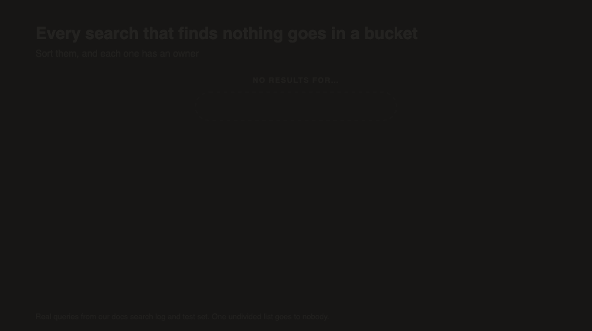

<!--
DRAFT 2 (voice pass). Sources: PostHog numbers read on 2026-10-14 (docs project, read-only); components/common/SearchModal.tsx, lib/analytics/agentTraffic.ts, app/api/mcp/route.ts, evals/search/JOURNAL.md.
-->

Every search box on the internet has a little message for when it comes up empty. "No results for 'ugc'." The reader sees it, sighs, and leaves.

Think about what just happened there, though. A real person wanted something, described it in their own words, and you either didn't have it or had it under a different name. That's some of the best feedback your site will ever get.

And most sites just throw it away.



## The standard

**You should be able to list last week's searches that returned nothing, and someone should read that list every week.**

## The 10-minute check

1. **Ask yourself, or your content lead: "What did people search for on our site last week that found nothing?"** Can you answer that without asking a developer to dig through logs?
2. **If you have an AI assistant, a chatbot, an API or an MCP server on your content,** can you answer the same question for the searches it ran?
3. **Search your own site for something you know you don't cover** (a competitor's feature name, or just nonsense). Then go find that search in your analytics. Is it there? Does it record that it found nothing?
4. **Think of the last time someone wrote or edited a page because of a failed search.** If you can't remember one, nobody's reading the list, even if it exists.

Most teams fail step 1 or step 3. We failed step 2 for a long time and didn't even know it.

## Why nobody reads the list

Blame defaults and ownership, again.

- Search analytics is off, or it lives somewhere nobody opens. Your search provider might keep a "no results" report, but only the developer who set it up can log into that dashboard. The content team never sees it.
- The search gets logged, but the result count doesn't. Plenty of setups record "a search happened" with the query and nothing else. Without the count, "found nothing" is invisible.
- Agent searches don't get logged at all. When an AI assistant searches your docs through an API or an MCP server, that request often never touches your front-end analytics. Those are some of the most precise questions you'll ever get, and they vanish.
- Typing noise drowns out the signal. Log every keystroke and "webhook" shows up as "we", "web", "webh"… with the real failures buried under the half-words.

## Catching every search that comes up empty

### The plan, on any stack

1. Log every search with its result count, from the search box AND from any agent tool. One event, 2 properties: the query, and the number of results.
2. Log the search the reader settled on. Skip the keystrokes in between.
3. Build one view: zero-result queries, most frequent first, for the last 7 days.
4. Alert on it. A daily alert when zero-result searches show up is enough to build the habit of looking.
5. Sort each query into one of 3 buckets:
   - **A content gap.** The answer isn't on your site. Write the page, or decide on purpose not to.
   - **A vocabulary gap.** The page exists, but it uses different words. Add the reader's words to it: a sentence, a heading, a synonym.
   - **A search problem.** The page exists and uses the words, and search still missed it. Fix the search (post 2 has the usual suspects).

Why bother with buckets? Each one goes to a different person. Content gaps go to writers. Vocabulary gaps are often a five-minute edit. Search problems go to a developer. One big undifferentiated list goes to nobody.

### How we wired it up

Our docs run on Agility CMS (yes, the one I co-founded) with a Next.js and React front end. Content is written in the CMS and indexed into Algolia for the ⌘K search box, and into Azure AI Search for agents. Both paths send PostHog events.

First, the search box. Results show up 150 ms after a keystroke, but the analytics event waits until the query has sat still for a full second. Closing the box sends the last query right away, so "searched, found nothing, gave up" doesn't get lost:

```tsx
// components/common/SearchModal.tsx
const flushSearch = useCallback(() => {
	if (searchTrackTimer.current) clearTimeout(searchTrackTimer.current);
	searchTrackTimer.current = null;
	if (pendingSearch.current) track("docs_search", pendingSearch.current);
	pendingSearch.current = null;
}, []);
// Closing the palette or navigating away still reports the last query, so
// "searched and gave up" isn't lost to the settle delay.
useEffect(() => flushSearch, [flushSearch]);
// ...
if (query.trim().length >= 2) {
	pendingSearch.current = { query, results: result.nbHits };
	if (searchTrackTimer.current) clearTimeout(searchTrackTimer.current);
	searchTrackTimer.current = setTimeout(flushSearch, 1000);
}
```

`results` is the number of hits Algolia reported, so "found nothing" is just `results = 0`. Pretty simple! A click on a result sends `docs_search_result_click` with the query and the position clicked. That covers the other kind of failure: searches that found something, just not the right thing.

Then the agent tool. Our MCP server (Model Context Protocol, a standard way to give AI assistants tools) has a `search_docs` tool that records the query and the hit count after every search:

```ts
// app/api/mcp/route.ts
trackMcpToolCall(
  "search_docs",
  { query, page: page || 0, hits: results.total, engine: results.engine, fallback: results.fallback },
  Date.now() - startTime,
  true
);
```

That becomes a server-side PostHog event, sent after the response so it never slows the agent down, and only from production:

```ts
// lib/analytics/agentTraffic.ts
const key = process.env.NEXT_PUBLIC_POSTHOG_KEY;
if (!key || !isProduction()) return;

const { query, objectID, hits, blocked, engine, fallback, topScore } = input.args as Record<string, unknown>;
await fetch(`${posthogHost()}/i/v0/e/`, {
	method: "POST",
	headers: { "content-type": "application/json" },
	body: JSON.stringify({
		api_key: key,
		event: "docs_mcp_tool_call",
		distinct_id: "agent:mcp",
		properties: {
			tool: input.tool,
			query: typeof query === "string" ? query.slice(0, 200) : null,
			hits: typeof hits === "number" ? hits : null,
			zero_results: hits === 0,
			// ...
			top_score: typeof topScore === "number" ? Math.round(topScore * 100) / 100 : null,
			// ...
		},
	}),
	signal: AbortSignal.timeout(2000),
});
```

3 details in there are worth stealing. The query is capped at 200 characters. Every agent shares one anonymous `distinct_id`, so no person profile gets created. And `zero_results` is a boolean, which makes the PostHog insight a plain filter instead of a numeric comparison. The whole thing is wrapped in a `try` that swallows errors, because analytics should never break search.

Last, the view and the alert. In PostHog, that's one trends insight per event (`docs_search` where `results = 0`, and `docs_mcp_tool_call` where `zero_results` is true), broken down by `query`, plus an alert on the agent tile. Any analytics tool that stores event properties can do this: Plausible and Umami with custom event properties, GA4 with a custom dimension, or a plain old database table.

On Algolia? Its own analytics has a "searches without results" report too, and you can read it through the Analytics API. Turn on click analytics (`clickAnalytics: true` on the query) and it'll also show searches that returned results nobody clicked.

## What our empty searches actually told us

The volume is small. Our PostHog search events start on 17 September 2026. From then to 14 October, the docs search box logged 79 searches from 15 people (by PostHog's count, our own team included), with 6 to 32 searches a week. We started logging agent searches through the MCP server on 6 October, and there were 76 that first week.

### The search box: 5 empty searches

Only 5 searches in that stretch found nothing:

- "ugc" is a content gap. Our docs don't cover user-generated content, and we knew it: it's the one deliberately unanswerable question in our 52-question test set. But a real reader asking is a good reason to write a short page that says so and points somewhere useful.
- "push pullcli" is a search problem: 2 words jammed together with no space. If the reader meant the CLI's push and pull commands, the engine couldn't split "pullcli" to find them, and a typo isn't the reader's fault.
- "ckl", "cklui" and "imn" are just noise. "ckl" and "cklui" were logged on the same day, one the start of the other: fragments of someone typing, from before we added the one-second settle delay. That delay exists because fragments like these were swamping the report.

Is 5 searches a content plan? Nope. But 1 real content gap and 1 fixable search problem out of 5 is a better hit rate than most planning meetings.

### The agent tool: our first alert was... us

Agents logged 9 zero-result searches in their first week. All 9 were on 6 October, and all 9 were one of 3 questions: "can I schedule content to publish later" (5 times), "what happens to nested content when I delete the parent item" (twice) and "how do I set up preview mode with the Next.js app router" (twice).

Look familiar? Those are the exact questions we were using that day to test the fix from post 2, run through the live endpoint. Our shiny new zero-result alert fired, and the "readers" it warned us about were our own team.

Oops.

2 fixes came out of that. Our test script now calls the search engine directly with analytics switched off (`analytics: false, clickAnalytics: false` for Algolia), so a test run never lands in the reports. And a habit: test against the engine directly, and leave production alone. If you must test production, tag the traffic so you can filter it out.

### Where we nearly broke our own signal

Since 7 October, 0 of 61 agent searches have come back empty. Some of that is the 4 settings from post 2 working. But on 13 October the agent tool moved to Azure AI Search hybrid search, which combines keywords with vectors (lists of numbers that represent meaning).

The problem? Vector search always finds a nearest neighbour, so it almost never returns zero results. Our zero-result tile for agents will sit at zero even when the docs have no answer.

We spotted this in our notes before the switch, not after, and replaced the signal a day later. The 2 obvious candidates both failed against the live index:

- "No keyword match." Our no-answer test questions still matched ordinary words like "editor" in nearly every top result.
- The hybrid score. It's a fusion score of about 0.03 that ranks results but doesn't measure them.

Watching agents reword a failed search was out too, because every agent call shares one anonymous ID.

What worked was Azure's semantic ranker, which scores each result from 0 to 4 for how well it answers the question. Every agent search now runs it for that score while keeping hybrid's order, and the event carries the best score as `top_score` (the line in the code above), plus `engine` and `fallback`. We added `top_score` so we can alert on low confidence instead of zero results. Below about 2.3 the docs probably don't answer, and post 7 gets into how far to trust that number.

One more gotcha: once you're past the free ranker quota, searches come back unscored and `top_score` is null. Count unscored searches separately, or silence will look like "no gaps".

So if you're adding vector search, figure out what replaces "no results" BEFORE you ship it.

### One index, 4 kinds of caller, and no labels

To check PostHog's count, I asked Algolia for the same period. It counted 666 searches on the docs index, 92 of them (13.8%) with no results. PostHog counted 79 from the search box.

So which one's right?

Well, they aren't measuring the same thing. The docs search box, the agent tool (until it moved to Azure), our test scripts and at least one other caller all query that one index, and we never told Algolia which was which. You can see it at the top of Algolia's no-results list: the 3 questions we tested with on 6 October, a nonsense string from a test run, and pairs of searches for our own blog-post titles. Those read like another site feature asking for related docs. They don't look like people typing.

So 13.8% isn't our search box's rate, and I can't tell you what is.

The fix is one parameter per caller. Algolia's `analyticsTags` lets you filter its reports by caller, so the search box now sends `["search-box"]` and the agent tool `["mcp"]`, and the main website is next. Tags only apply from the day you add them, though, so if a shared index has more than one caller, tag each one from day one.

And one thing we still aren't doing: tracking how many zero-result searches turned into new or edited pages. That's the number that proves the habit works, and it's the next one we'll add.

## Your readers are writing your backlog

This one's mostly for people. A zero-result list is the cheapest content strategy there is: your readers write your backlog for you, in their own words, every day, for free! Fix a vocabulary gap with the reader's own phrase and you help the next person who types it, plus the agent searching on their behalf. A page that says "we don't support that, here's what to do instead" saves a support ticket.

Our biggest vocabulary gap so far didn't even come from the list. "How do I let editors click on the page to edit it" ranked poorly on every engine we tried, because our docs never describe the feature that way. No amount of search tuning fixes that. Adding the reader's words to the page does.

## Over to you

Can you answer step 1 of the check today? If you can, what's the strangest query on your zero-results list, and which bucket did it land in? Let me know in the comments!

Next in the series: **Measure your search before you change it.**

*BTW, an AI coding agent did a lot of the heavy lifting on this one, including the first draft of this post. Every number here comes from our own site, and so does every mistake.*
